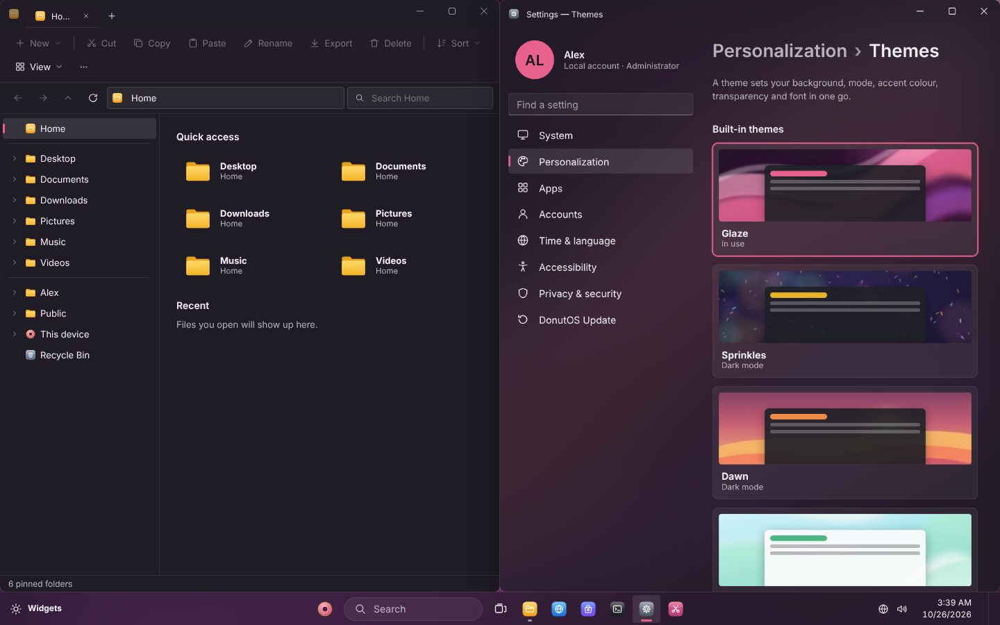
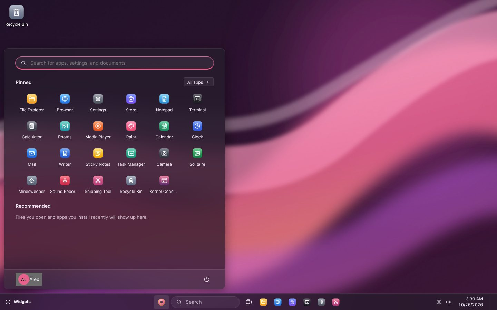
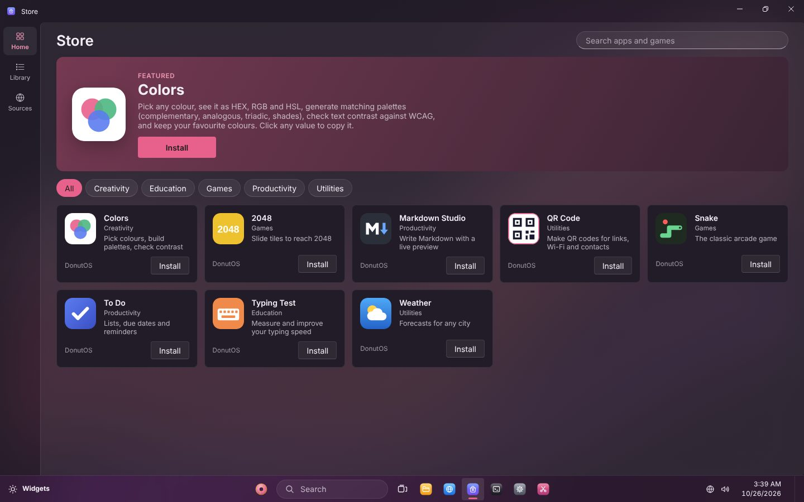
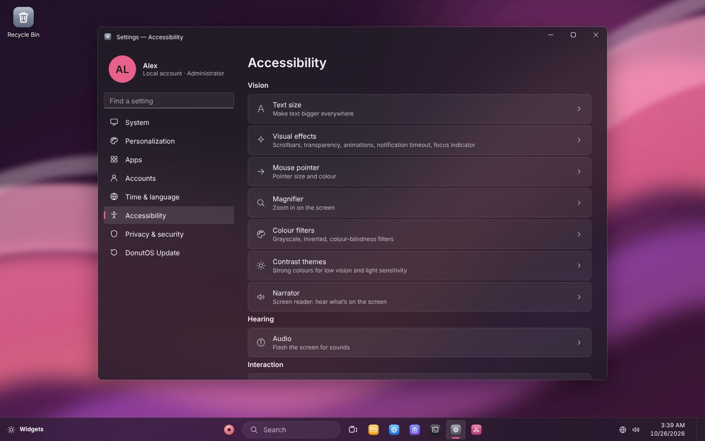
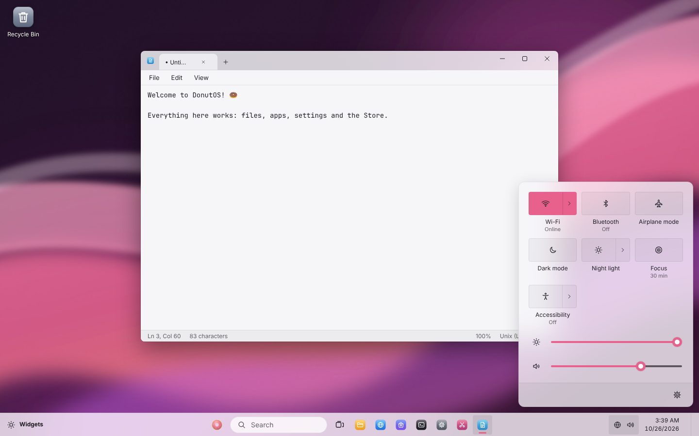

# DonutOS 🍩

**A whole desktop computer in one app.** DonutOS has a taskbar, Start menu, windows you can
snap side by side, virtual desktops, File Explorer, a Terminal, Settings, an app Store and about
twenty apps: Notepad, Writer, Paint, Photos, Calculator, Calendar, Mail, a web Browser, games
and more. It runs as a desktop app on Windows, Mac, Linux and Chromebooks, or straight in a web
browser.



| | |
|---|---|
|  |  |
|  |  |

---

## Contents

- [Get DonutOS](#get-donutos)
  - [Download the desktop app](#download-the-desktop-app-recommended)
  - [Which file do I download?](#which-file-do-i-download)
  - [Install on Windows](#windows) · [Mac](#mac) · [Chromebook](#chromebook) · [Linux](#linux)
  - [Or use it in your web browser](#or-use-it-in-your-web-browser)
- [Your first start](#your-first-start)
- [Getting around](#getting-around)
- [Your files](#your-files)
- [Updates](#updates)
- [Accessibility](#accessibility)
- [Something's not working](#somethings-not-working)
- [Uninstalling](#uninstalling)
- [For developers](#for-developers)

---

## Get DonutOS

### Download the desktop app (recommended)

1. Go to the **[latest release](https://github.com/Domuty/DonutOS/releases/latest)**.
2. Under **Assets**, click the file for your computer (see the table below).
3. Follow the steps for [Windows](#windows), [Mac](#mac), [Chromebook](#chromebook) or [Linux](#linux).

The desktop app is the full experience: every website works in DonutOS's Browser (including
signing in), and your files are real files on your computer.

### Which file do I download?

| Your computer | File to download |
|---|---|
| **Windows** 10 or 11 (any PC, including ARM laptops) | `DonutOS-Setup-1.0.0.exe` |
| **Mac** (Intel or Apple silicon M1/M2/M3/M4) | `DonutOS-1.0.0-mac.dmg` |
| **Chromebook** with an Intel or AMD processor | `DonutOS-1.0.0-linux-amd64.deb` |
| **Chromebook** with an ARM processor (MediaTek, Snapdragon…) | `DonutOS-1.0.0-linux-arm64.deb` |
| **Linux** PC (Ubuntu, Debian, Mint…) | `DonutOS-1.0.0-linux-amd64.deb` |
| **Linux**, any distribution | `DonutOS-1.0.0-linux-x86_64.AppImage` (or `…-arm64.AppImage` on ARM) |

The version number in the file names (`1.0.0`) will be higher for newer releases. Always pick
the latest one.

### Windows

1. Double-click **`DonutOS-Setup-….exe`**.
2. You may see **"Windows protected your PC"**. DonutOS isn't signed with a paid Microsoft
   certificate, so Windows doesn't recognise it yet. Click **More info**, then **Run anyway**.
3. Choose where to install it (the suggested folder is fine) and click **Install**.
4. Open DonutOS from the **desktop shortcut** or the **Start menu**.

### Mac

1. Double-click **`DonutOS-….dmg`**, then drag **DonutOS** into the **Applications** folder.
2. Open **Applications** and **right-click** (or Control-click) DonutOS, then choose **Open**,
   and **Open** again in the box that appears. You only need to do this the first time.
   - If the Mac says the app *"can't be opened"* or *"is damaged"*: open **System Settings ›
     Privacy & Security**, scroll down and click **Open Anyway** next to DonutOS. This happens
     because DonutOS isn't signed with a paid Apple developer certificate.

### Chromebook

DonutOS runs on Chromebooks through ChromeOS's built-in Linux support.

1. **Turn on Linux** (once): open **Settings › About ChromeOS › Developers › Linux development
   environment › Set up** (on older versions: Settings › Advanced › Developers). Follow the
   steps; it takes a few minutes.
   - Don't see this option? Your Chromebook is probably managed by a school or workplace that
     has turned Linux off. Use the [web version](#or-use-it-in-your-web-browser) instead.
2. **Check which kind of processor you have:** open the **Terminal** app (it appeared in
   your launcher when Linux was installed), type the command below and press Enter:
   ```
   dpkg --print-architecture
   ```
   It answers **`amd64`** (Intel/AMD) or **`arm64`** (ARM). Download the matching `.deb` file
   from the [table above](#which-file-do-i-download).
3. Open the **Files** app, go to **Downloads**, double-click the `.deb` file and choose
   **Install with Linux**. Click **Install**.
4. Open **DonutOS** from your launcher. Linux apps sit in a **"Linux apps"** folder there.
   Press the full-screen key (the rectangle in the top row) for full screen.

Linux apps on a Chromebook run in a small virtual machine, so DonutOS needs a moment to start
and runs best on Chromebooks with 8 GB of memory or more.

### Linux

- **`.deb` (Ubuntu, Debian, Mint, Pop!_OS…):** double-click it to open your software installer,
  or run `sudo apt install ./DonutOS-1.0.0-linux-amd64.deb` in the folder you downloaded it to.
  DonutOS then appears in your app menu.
- **AppImage (any distribution):** right-click the file › **Properties** › **Permissions** and
  tick **Allow executing file as program** (or run `chmod +x DonutOS-*.AppImage`). Then
  double-click it.
  - On Ubuntu 22.04 and newer, AppImages need `libfuse2`: `sudo apt install libfuse2` (on
    Ubuntu 24.04 the package is called `libfuse2t64`).

### Or use it in your web browser

DonutOS also runs in any modern browser (Chrome, Edge, Firefox, Safari), and can be installed
like an app that works offline.

1. Open the DonutOS web address: the site where you or a friend published DonutOS (see
   [Publish your own web version](#publish-your-own-web-version)).
2. Install it as an app (optional):
   - **Chrome or Edge** (Windows, Mac, Linux, Chromebook): click the install icon at the right
     end of the address bar, or **⋮ › Cast, save and share › Install page as app**.
   - **Android:** **⋮ › Add to Home screen › Install**.
   - **iPhone and iPad (Safari):** **Share › Add to Home Screen**.

Good to know about the web version:
- **Your files are kept inside the browser.** Clearing the site's data erases them. Use File
  Explorer's **Export** to save copies to your computer.
- **The Browser app** shows websites through a relay on the server DonutOS is published on.
  Signing in to websites doesn't work there, and some video or very interactive sites may not
  either. For full web browsing, use the desktop app.

---

## Your first start

DonutOS starts with a short setup:

1. **Name this device**, for example "Alex's laptop".
2. **Create your account:** your name, then an optional password and PIN (you can add them
   later in Settings › Accounts).
3. **Make it yours:** choose light or dark mode, an accent colour and a wallpaper.

Need help seeing or using the screen? The **accessibility button** in the bottom-right corner of
setup (and of the sign-in screen) turns on Narrator, Magnifier, the on-screen keyboard, a
contrast theme or Sticky Keys before you start.

---

## Getting around

| To… | Do this |
|---|---|
| Open an app | Click the **🍩 Start** button (or press **Win**) and choose an app, or just start typing its name |
| Search for apps, settings and files | Press **Win+S**, or click **Search** on the taskbar |
| Change Wi-Fi, volume, brightness, dark mode | Click the network/volume icons at the bottom right (**Win+A**) |
| See notifications and the calendar | Click the clock (**Win+N**) |
| Snap a window to half the screen | Drag its title bar to the left or right edge, or press **Win+←** / **Win+→** |
| Pick a layout for a window | Hover over the window's maximise button |
| Switch between windows | **Alt+Tab** |
| See all windows and desktops | **Win+Tab** (Task view) |
| Lock the screen | **Win+L** |
| Take a screenshot | **Print Screen** (whole screen) or **Win+Shift+S** (part of it) |
| Close a window | **Alt+F4** |

**No Win key, or your computer uses it?** Every Win shortcut also works as **Ctrl+Alt**+the
same key, for example **Ctrl+Alt+S** for Search and **Ctrl+Alt+L** to lock. The full list is in
**Settings › System › Keyboard shortcuts**.

**Get more apps** from the **Store** (on the taskbar): Weather, To Do, games and more.

---

## Your files

- **Desktop app:** your DonutOS files are real files in your computer's **Documents › DonutOS**
  folder, so you can open them from your computer too. Each DonutOS user has their own folder
  inside it.
- **Web version:** files live in the browser's storage on that device. In File Explorer,
  **Import** brings files in from your computer and **Export** saves copies out.

Deleted files go to the **Recycle Bin** until you empty it.

---

## Updates

DonutOS keeps itself up to date:

- **Windows, Linux and Chromebook:** new versions download in the background and install
  when you restart DonutOS. With the `.deb` package on a Linux PC, your computer asks for your
  password to finish installing.
- **Mac:** DonutOS tells you when a new version is out. Click **Open the download page**,
  download the new `.dmg` and drag DonutOS into Applications again, replacing the old one. Your
  files and settings are kept. (Updating by itself needs a paid Apple certificate.)
- **Web version:** updates arrive automatically when you reload the page.

Check any time in **Settings › DonutOS Update**, where you can also turn automatic updates off.

---

## Accessibility

**Settings › Accessibility** (shortcut **Win+U**) has:

- **Text size** and **Visual effects:** bigger scrollbars, no animations, a thicker focus
  outline, and longer notifications.
- **Mouse pointer:** bigger, or in black or your accent colour.
- **Magnifier:** zoom in on the screen (**Win+Plus**, **Win+Minus**, **Win+Esc**).
- **Colour filters:** grayscale, inverted and colour-blindness filters.
- **Contrast themes:** four high-contrast colour schemes (**Alt+Shift+Print Screen**).
- **Narrator:** a screen reader that reads the screen aloud (**Ctrl+Win+Enter**).
- **Audio:** flash the screen when a sound plays.
- **Keyboard:** Sticky Keys (press Shift five times), Bounce Keys, Toggle Keys and an
  on-screen keyboard (**Ctrl+Win+O**).

Quick switches are also in **Quick Settings › Accessibility**. Everything works with the
keyboard alone: **Tab** moves between areas and the **arrow keys** move within them.

---

## Something's not working

| Problem | Fix |
|---|---|
| Windows says "Windows protected your PC" | Click **More info › Run anyway**. See [Windows](#windows). |
| Mac says DonutOS "can't be opened" or "is damaged" | Right-click › Open, or System Settings › Privacy & Security › **Open Anyway**. See [Mac](#mac). |
| The AppImage doesn't start | Make it executable and install `libfuse2`. See [Linux](#linux). |
| No Linux option on a Chromebook | It's turned off on managed Chromebooks. Use the [web version](#or-use-it-in-your-web-browser). |
| I forgot my password | On the sign-in screen choose **I forgot my password**. If there's no hint or other account to help, **Reset DonutOS…** erases it so you can set it up again. On the desktop app your files in Documents › DonutOS are erased too. |
| A website won't load in the web version's Browser | Some sites block servers or need sign-in. Open it in a normal browser tab (⋯ menu › **Open in my computer's browser**), or use the desktop app. |
| Narrator is silent | It uses your computer's voices. Check the volume, and that a voice is chosen in Settings › Accessibility › Narrator. On Linux, install `speech-dispatcher`. Turn on captions to see what it says. |
| Something else | [Open an issue](https://github.com/Domuty/DonutOS/issues) describing what you did and what happened. |

---

## Uninstalling

- **Windows:** Settings › Apps › Installed apps › DonutOS › **Uninstall**.
- **Mac:** drag DonutOS from Applications to the Bin.
- **Chromebook:** right-click DonutOS in the launcher › **Uninstall**.
- **Linux:** `sudo apt remove donutos`, or delete the AppImage.

Your files stay in **Documents › DonutOS** until you delete that folder yourself.

---

## For developers

### Run it from the source code

You need [Node.js](https://nodejs.org) 20 or newer and [Git](https://git-scm.com).

```bash
git clone https://github.com/Domuty/DonutOS.git
cd DonutOS
npm install
npm run serve            # web version → http://localhost:5173
npm start                # desktop version (full screen; quit with Start › Power › Shut down)
npm run start:windowed   # desktop version in a normal window
npm start -- --devtools  # with Chromium DevTools
```

### Test

```bash
npm run test:node      # file-system sandbox, frame check and relay tests
npm run test:desktop   # the core test suite inside Electron
```

Web: open http://localhost:5173/tests/index.html, or Kernel Console › **Run core tests**.
GitHub runs the tests on every push (`.github/workflows/ci.yml`).

### Build installers yourself

```bash
npm run dist:win     # on Windows → dist/DonutOS-Setup-<version>.exe (x64 + ARM64 in one)
npm run dist:mac     # on a Mac   → dist/DonutOS-<version>-mac.dmg and .zip (Intel + Apple silicon)
npm run dist:linux   # on Linux   → AppImage and .deb for x64 and ARM64
```

### Make a release

Releases are built and published by GitHub Actions (`.github/workflows/release.yml`):

```bash
npm version patch          # 1.0.0 → 1.0.1: updates package.json and creates the tag v1.0.1
git push --follow-tags
```

GitHub then tests DonutOS and builds the Windows, Mac and Linux installers on its own
computers. It publishes them as a release on the
[Releases page](https://github.com/Domuty/DonutOS/releases), where installed copies find them.
You can also start it from the **Actions** tab (Release › Run workflow). If the workflow can't
create the release, check the repository's **Settings › Actions › General › Workflow permissions**
allows **Read and write**.

### Publish your own web version

Push the repository to GitHub, then import it in [Vercel](https://vercel.com) (free). The
`vercel.json` file configures everything, including the Browser's `api/relay` and
`api/frame-check` functions. On static hosts without functions (such as GitHub Pages),
everything except the Browser relay works.

### Make apps for the Store

In DonutOS's Terminal type `dapp new MyApp`, edit `main.js`, then `dapp install`. The full guide
(API, package format, publishing your own catalog) is in [docs/SDK.md](docs/SDK.md).
After changing the built-in Store apps in `src/store/apps/`, run `npm run build:catalog`.

### How it fits together

See [docs/ARCHITECTURE.md](docs/ARCHITECTURE.md). In short:
- **One shared code base:** `src/` serves both the web version and the desktop version.
- **Platform adapters:** `src/platform/` is the only place that knows which one is running.
- **Desktop shell:** `electron/` holds the desktop wrapper.

---

## License

[MIT](LICENSE). DonutOS is original work. Its name, donut logo, icons and wallpapers belong to
the DonutOS project and are not affiliated with any other operating system.
